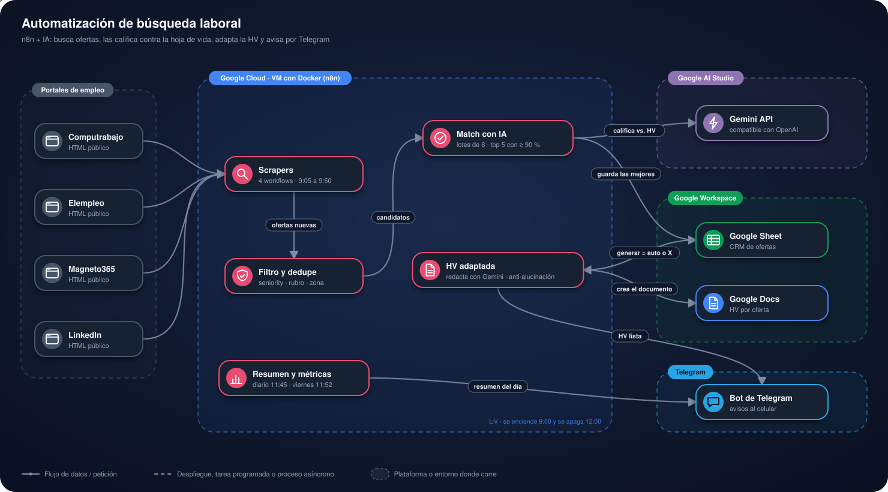

# Automatización de búsqueda laboral con n8n + IA

<p>
  
</p>


## Contenido

1. [Presentación](#1-presentación)
2. [Estructura del proyecto](#2-estructura-del-proyecto)
3. [Arquitectura](#3-arquitectura)
4. [Plataformas y su función](#4-plataformas-y-su-función)
5. [Cómo usar la plataforma](#5-cómo-usar-la-plataforma)
6. [Instalación para pruebas](#6-instalación-para-pruebas)
7. [Adáptalo a tu país](#7-adáptalo-a-tu-país)
8. [Licencia](#8-licencia)

---

## 1. Presentación

Sistema self-hosted que automatiza la búsqueda de empleo de punta a punta: scrapea ofertas, las filtra, les asigna un % de compatibilidad contra tu hoja de vida (HV) usando un LLM, se queda solo con las mejores, genera una HV adaptada a cada una y te avisa por Telegram. Corre en una VM de Google Cloud con Docker.

### En pocas palabras

- **Qué hace:** cada mañana de lunes a viernes revisa cuatro portales de
  empleo, descarta lo que no sirve y le pide a una IA que califique qué tanto
  encaja cada oferta con la hoja de vida. Solo se queda con las mejores.
- **Qué entrega:** una planilla con las ofertas elegidas, una hoja de vida
  adaptada a cada una (sin inventar experiencia) y avisos por Telegram.
- **Cómo ejecutarlo:** ve a [Instalación para pruebas](#6-instalación-para-pruebas); para
  dejarlo en la nube, a [`DESPLIEGUE-GOOGLE-CLOUD.md`](DESPLIEGUE-GOOGLE-CLOUD.md).

### Qué hace

- **Recolecta** ofertas nuevas de cuatro portales de empleo, buscando por los perfiles y keywords que definas en el `.env` (`PERFILES_BUSQUEDA`).
- **Filtra** automáticamente por antigüedad (máximo 3 días de publicación), salario (≥ $3.000.000 COP o no especificado/a convenir), seniority, rubro y zona antes de gastar IA.
- **Evalúa con IA (Gemini)** cada oferta nueva contra tu HV, por lotes de 8 ofertas por llamada, y **guarda solo las 5 mejores de cada fuente con match ≥ 83%**. Las descartadas se recuerdan 21 días para no volver a evaluarlas.
- **Guarda** las elegidas en una Google Sheet que funciona como CRM personal.
- **Genera la HV adaptada** automáticamente para esas ofertas, en **Google Docs y en PDF** (`HV_<Nombre>_<Oferta>`), lista para subir a los portales, que no aceptan Google Docs. Reglas fijas:
  - no inventa experiencia, empresas, títulos ni certificaciones;
  - experiencia, formación y certificaciones en **orden cronológico, de lo más reciente a lo más antiguo**;
  - conserva **todos los enlaces** de la HV base (LinkedIn, portafolio, título y certificados) y los deja clicables; si la IA omite alguno, se reintenta y, si aun así falta, la fila queda marcada con `FALTAN ENLACES`;
  - el nombre y la línea de contacto se copian textuales de la HV base, nunca los escribe la IA.

  El Doc y el PDF se guardan en la carpeta del Drive definida en `DRIVE_CARPETA` (por defecto `HV`; se crea sola la primera vez). También puedes marcar filas a mano con una `X` en `generar`.
- **Limpia el Drive** cada viernes: manda a la papelera los Docs y PDF de HV con más de 15 días (recuperables durante 30 días).
- **Chequea anti-alucinación**: compara la HV generada contra la HV base y marca términos que no coinciden para revisarlos antes de enviarla.
- **Te avisa por Telegram** cada HV lista (con botones al PDF, al Google Doc y a la oferta), más un resumen del día antes de que se apague la VM.
- **Mide el embudo** (alto match → postulación → entrevista) con un resumen semanal los viernes.

### Horario (L-V, hora local)

La hora local es la de `ZONA_HORARIA` en el `.env`. La VM se enciende a las 9:00 y se apaga a las 12:00 (política de horario de GCP), así que todo ocurre dentro de esa ventana, viernes incluido:

| Hora | Workflow |
|---|---|
| 9:05 | Ofertas del portal 1 |
| 9:20 | Ofertas del portal 2 |
| 9:35 | Ofertas del portal 3 |
| 9:50 | Ofertas del portal 4 |
| 10:05 → 11:35 (cada 15 min) | Generar HV adaptada GO |
| 11:40 (solo viernes) | Limpieza Drive HV GO |
| 11:45 | Resumen diario por Telegram GO |
| 11:52 (solo viernes) | Metricas semanales GO |

### Stack

- [n8n](https://n8n.io/) self-hosted (Docker): todo el scraping y las llamadas a IA son Code nodes en JS puro (`this.helpers.httpRequest`).
- [Gemini API](https://aistudio.google.com/apikey) (Google AI Studio, nivel gratuito), por su endpoint compatible con OpenAI. Si `gemini-3.8-flash` se queda sin cuota o está saturado, los workflows pasan solos a `gemini-flash-lite-latest` y luego a `gemini-3.5-flash-lite`.
- Google Sheets + Google Docs + Google Drive API: CRM, HV en Google Docs y exportación a PDF.
- Telegram Bot API: notificaciones.
- n8n fijado en la versión `2.45.5`, la última estable, al día en seguridad. Cada día hábil
  un workflow de GitHub Actions la actualiza solo si sale una versión estable más nueva.
- La VM se sincroniza sola con `main` (al encender y cada 5 minutos); solo reinicia n8n
  cuando cambian los workflows o el `docker-compose.yml`.

---

## 2. Estructura del proyecto

```
.
├── docker-compose.yml       # n8n self-hosted
├── .env.example             # plantilla de variables de entorno
├── workflows/
│   ├── job(s)-<portal>.json         # un workflow por portal: recolección + match IA
│   ├── generar-hv-adaptada.json     # HV adaptada por IA + Google Doc + PDF + chequeo anti-alucinación
│   ├── resumen-diario-telegram.json # resumen diario de ofertas con match >= 83%
│   ├── metricas-semanales.json      # embudo de conversión, viernes
│   └── limpieza-drive-hv.json       # viernes: HV (Doc y PDF) con más de 15 días a la papelera
├── infra/                   # sincronización de la VM con GitHub (arranque, script y cron)
├── .github/workflows/       # CI, actualización diaria de n8n y depuración quincenal
├── docs/                    # diagrama de arquitectura y badge del horario
├── DESPLIEGUE-GOOGLE-CLOUD.md
└── README.md
```

---

## 3. Arquitectura

<p align="center">
  
</p>

- Los **scrapers** leen el HTML público de cada portal; el filtro descarta por
  seniority, rubro y zona antes de gastar IA.
- **Gemini** califica las ofertas por lotes y también redacta la HV adaptada.

Los workflows son independientes entre sí y se coordinan únicamente a través de la Google Sheet.

### Notas

- Los parsers leen el HTML público de cada sitio; si cambian su markup, el nodo `Parsear HTML` correspondiente devuelve 0 resultados sin error.
- Si una búsqueda puntual falla (error 4xx/5xx del portal), se reintenta y, si sigue fallando, esa keyword aporta 0 ofertas y el resto del workflow continúa.
- Si Gemini no logra evaluar ninguna oferta (cuota agotada, key inválida), la ejecución queda en rojo en n8n con el motivo, en vez de terminar "exitosa" sin datos.
- Cada workflow tiene, además de su horario, un disparador manual (`Ejecutar a mano (prueba)`) para probarlo desde el editor o por CLI sin afectar el horario.

---

## 4. Plataformas y su función

| Plataforma | Función en el proyecto |
|---|---|
|  | Una VM con Docker corre n8n; una política de horario la enciende a las 9:00 y la apaga a las 12:00, de lunes a viernes. |
|  | Orquesta los workflows: recolección, filtro, evaluación con IA, HV adaptada, resumen y métricas. |
|  | Empaqueta n8n con `docker-compose.yml`, igual en local y en la VM. |
|  | Califica el % de compatibilidad de cada oferta y redacta la HV adaptada. |
|  | Funciona como CRM: guarda las ofertas elegidas y coordina los workflows. |
|  | Guarda cada HV adaptada con formato real y enlaces clicables. |
|  | Guarda Doc y PDF de cada HV en la carpeta `HV`, y los viernes manda a la papelera los de más de 15 días. |
|  | Avisa cada HV lista y envía el resumen del día y las métricas semanales. |

---

## 5. Cómo usar la plataforma

El sistema corre solo; tu trabajo diario ocurre en la planilla y en Telegram.

### 5.1 Revisar las ofertas del día

1. A partir de las 10:00, abre la Google Sheet: cada fila es una oferta con
   **match ≥ 83%**, con su `fuente`, `titulo`, `empresa`, `ubicacion`, `url`,
   `match_pct`, `ats_tip` y `perfil_sugerido`.
2. A medida que se generan las HV, llegan avisos por Telegram con botones al PDF
   (`hv_pdf`), al Google Doc (`hv_adaptada`) y a la oferta.

### 5.2 Revisar la HV adaptada

1. Abre el Google Doc de la oferta.
2. Si la columna `posible_alucinacion` marca términos, compáralos con tu HV base y
   corrígelos antes de enviarla. Si dice `FALTAN ENLACES`, agrega el enlace indicado.
3. Para postularte, sube el **PDF** (`hv_pdf`). Si corregiste el Google Doc, descarga
   de nuevo el PDF desde el Doc (*Archivo → Descargar → PDF*), porque el PDF
   automático no se actualiza solo.

### 5.3 Regenerar una HV

Borra el contenido de `hv_adaptada` (y `hv_pdf`) de la fila, dejando `auto` o `X` en
`generar`: el siguiente ciclo la vuelve a crear con la HV base vigente.

### 5.4 Pedir una HV para otra oferta

Escribe una `X` en la columna `generar` de cualquier fila: el siguiente ciclo de
**Generar HV adaptada** (cada 15 minutos, entre 10:05 y 11:35) la crea.

### 5.5 Registrar tus postulaciones

Actualiza `fecha_postulacion` (por ejemplo `2026-10-23` o `23/10/2026`) y `estado` de
cada oferta. El resumen de los viernes mide el embudo con estas columnas:

| Valor de `estado` | Cómo cuenta |
|---|---|
| `Pendiente` | Lo escriben los workflows al guardar la oferta: aún no te postulas. |
| `Postulado` | Te postulaste. También cuenta cualquier fila con `fecha_postulacion`. |
| `Entrevista` | Te llamaron a entrevista (cuenta también como postulada). |
| `Descartado` | No te vas a postular: no entra en el embudo. |

Cada línea del resumen indica la columna de la que sale. Los `match_pct` en 0 o vacíos
no se usan en los promedios, y "Esta semana" son los últimos 7 días según
`fecha_deteccion` y `fecha_postulacion`.

### 5.6 Resúmenes por Telegram

- **11:45:** resumen diario de las ofertas con match ≥ 83%, con enlaces a la HV en PDF y en Google Docs.
- **11:52, solo viernes:** métricas semanales del embudo.

---

## 6. Instalación para pruebas

### Configuración

1. **Google Sheet**: los workflows usan la **primera pestaña** del archivo (sin importar su nombre), con esta fila de encabezados (mismo orden y nombres):

```
fuente | titulo | empresa | ubicacion | url | keyword_busqueda | fecha_deteccion | fecha_postulacion | generar | hv_adaptada | posible_alucinacion | estado | match_pct | ats_tip | perfil_sugerido | notificado | hv_pdf
```

   Si falta la columna `hv_pdf`, el workflow de HV la crea al final la primera vez que genera un PDF.
   Comparte la planilla como **Restringido** (solo tú): nunca "cualquiera con el enlace".

2. **`.env`**: copia `.env.example` a `.env` y complétalo. Todo lo personal y
   todo lo que depende de tu país está ahí; los workflows no tienen datos fijos.
   **Una variable por línea**: si dos quedan pegadas, la segunda desaparece sin ningún error.

   | Variable | Para qué |
   |---|---|
   | `GEMINI_API_KEY`, `GEMINI_MODEL` | IA que evalúa ofertas y redacta la HV |
   | `TELEGRAM_BOT_TOKEN`, `TELEGRAM_CHAT_ID` | avisos por Telegram |
   | `SHEET_ID` | ID de tu Google Sheet (lo que va entre `/d/` y `/edit` en la URL) |
   | `HV_BASE_TEXT` | tu HV en una sola línea, con los saltos como `\n`: línea 1 tu nombre, línea 2 tu contacto |
   | `HV_PREFIJO_ARCHIVO` | prefijo de los archivos (`<prefijo>_<Oferta>`); la limpieza solo borra archivos con este prefijo |
   | `DRIVE_CARPETA` | carpeta del Drive para las HV (por defecto `HV`) |
   | `ZONA_HORARIA`, `PAIS` | horario local y contexto de país para la IA |
   | `PERFILES_BUSQUEDA` | perfiles y keywords a buscar (JSON) |
   | `ZONA_REGEX`, `EXCLUIR_PUESTO_REGEX`, `EXCLUIR_RUBRO_REGEX` | qué ubicaciones aceptar y qué puestos/rubros descartar |
   | `COMPUTRABAJO_DOMINIO`, `UBICACION_*` | dominio y ubicación de cada portal |

3. **Criterios fijos**: `umbral_match` (83), `max_ofertas` (5) y `max_candidatos` (30) están en el nodo `Config (perfiles + criterios)` de cada scraper. Se filtran automáticamente publicaciones de más de 3 días y salarios explícitos menores a $3.000.000 COP.

### Cómo ejecutarlo

1. Completa la [Configuración](#configuración) (planilla y `.env`).
2. Levanta n8n:
   ```bash
   docker compose up -d
   ```
3. Abre `http://localhost:5678`, importa los archivos de `workflows/`
   (*Import from File*, o
   `docker exec -u node n8n n8n import:workflow --separate --input=/workflows`)
   y crea las credenciales OAuth2 de Google Sheets y Google Docs con estos nombres
   exactos: **`Google Sheets account`** y **`Google Docs account`** (los workflows
   las enlazan por nombre; la de Docs también se usa en Drive para el PDF, la
   carpeta y la limpieza).
   - En Google Cloud, la app OAuth debe estar **"En producción"**: en modo
     "Prueba" Google anula el permiso a los 7 días y la planilla deja de llenarse.
   - Redirect URI autorizada: `http://localhost:5678/rest/oauth2-credential/callback`.
     En la VM, se entra al editor con un túnel SSH
     (`gcloud compute ssh <nombre-de-la-vm> --zone <zona> --ssh-flag="-L 5678:localhost:5678" --ssh-flag="-N"`)
     y se abre `http://localhost:5678`.
4. Activa los workflows. Desde ese momento corren solos según el
   [horario](#horario-l-v-hora-local).

### Despliegue

Para dejarlo en la nube, sigue [`DESPLIEGUE-GOOGLE-CLOUD.md`](DESPLIEGUE-GOOGLE-CLOUD.md).

---

## 7. Adáptalo a tu país

Todo se ajusta desde el `.env`, sin tocar los workflows:

1. **Zona horaria y país**: `ZONA_HORARIA` (formato IANA, ej. `America/Mexico_City`)
   y `PAIS`. Si usas la VM con horario, crea la política de encendido/apagado en la
   misma zona horaria.
2. **Portales**:
   - **Computrabajo** tiene un dominio por país: cambia `COMPUTRABAJO_DOMINIO`
     (`mx.computrabajo.com`, `ar.computrabajo.com`, `pe.computrabajo.com`…) y pon en
     `UBICACION_COMPUTRABAJO` el slug de tu ciudad tal como aparece en sus URLs.
   - **LinkedIn** funciona en cualquier país: pon tu ciudad en `UBICACION_LINKEDIN`.
   - **Elempleo** y **Magneto365** solo operan en Colombia: en otro país, desactiva
     esos dos workflows.
   - Para sumar otro portal, duplica un workflow de scraper y cambia la URL de
     búsqueda y el nodo `Parsear HTML`.
3. **Qué buscar**: `PERFILES_BUSQUEDA` (JSON con perfiles y keywords) y `ZONA_REGEX`
   (tu ciudad + remoto/híbrido). Si los filtros por defecto de seniority o rubro no te
   sirven, reemplázalos con `EXCLUIR_PUESTO_REGEX` y `EXCLUIR_RUBRO_REGEX`.
4. **Tu HV**: `HV_BASE_TEXT` y `HV_PREFIJO_ARCHIVO`. La IA conserva tu nombre, tu
   contacto y todos los enlaces tal como estén en la HV base.
5. **Gemini**: confirma que el nivel gratuito de la API esté disponible en tu país.

---

## 8. Licencia

> 📘 **[Manual de usuario](docs/MANUAL.md)**: cómo usar el sistema campo por campo, qué datos se ingresan y qué garantiza en seguridad.

MIT.
