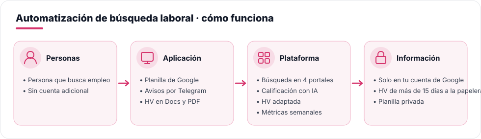

# 📘 Manual de usuario · Automatización de búsqueda laboral

## 1. Portada

| | |
|---|---|
| **Producto** | Automatización de búsqueda laboral (n8n + IA) |
| **Documento** | Manual de usuario |
| **Versión** | 2.0 · noviembre de 2026 |
| **Dirigido a** | La persona que busca empleo y usa el sistema |
| **Autor** | Luis F. A. |

## Contenido

1. [Portada](#1-portada)
2. [Introducción](#2-introducción)
3. [Objetivo](#3-objetivo)
4. [Alcance](#4-alcance)
5. [Acceso al sistema](#5-acceso-al-sistema)
6. [Pantalla principal](#6-pantalla-principal)
7. [Navegación](#7-navegación)
8. [Funcionalidades](#8-funcionalidades)
9. [Gestión de perfil](#9-gestión-de-perfil)
10. [Mensajes frecuentes](#10-mensajes-frecuentes)
11. [Preguntas frecuentes](#11-preguntas-frecuentes)
12. [Glosario](#12-glosario)

---

## 2. Introducción

Cada mañana de lunes a viernes, el sistema revisa cuatro portales de empleo, descarta lo que no
encaja, le pide a una inteligencia artificial que califique cada oferta contra tu hoja de vida (HV)
y se queda con las mejores. Para ellas genera una HV adaptada, sin inventar experiencia, y te avisa
por Telegram.

No tiene una página web propia: trabajas con una **planilla de Google** y con los **mensajes de
Telegram**. Este manual explica cómo usarlos.

## 3. Objetivo

Que encuentres a diario las ofertas que mejor encajan con tu perfil, con una HV adaptada a cada
una, y lleves el seguimiento de tus postulaciones sin trabajo manual.

## 4. Alcance

**Incluye:** búsqueda en cuatro portales, filtro por antigüedad, salario, cargo y zona, calificación
con IA, HV adaptada en Google Docs y PDF, avisos y resumen diario por Telegram, botones para registrar
tus postulaciones y métricas semanales.

**No incluye:** postularse por ti: tú revisas la HV y la subes al portal.

**Qué necesitas:** acceso a tu planilla de Google y a Telegram en el celular.

## 5. Acceso al sistema

No hay usuario ni contraseña propios: entras a tu **planilla de Google** con tu cuenta de Google y
recibes los avisos en el **chat de Telegram** configurado. Comparte la planilla como
**Restringido** (solo tú), nunca "cualquiera con el enlace".

## 6. Pantalla principal

La **planilla** es la pantalla principal: cada fila es una oferta elegida.

| Columna | Qué contiene | ¿La editas tú? |
|---|---|---|
| `fuente` | Portal de origen | No |
| `titulo`, `empresa`, `ubicacion`, `url` | Datos de la oferta | No |
| `match_pct` | Porcentaje de compatibilidad calculado por la IA | No |
| `ats_tip` | Sugerencia para pasar filtros automáticos de selección | No |
| `perfil_sugerido` | Perfil de búsqueda con el que encaja | No |
| `generar` | `auto` (la eligió el sistema) o `X` para pedir una HV a mano | Sí |
| `hv_adaptada` | Enlace al Google Doc de la HV adaptada | Bórralo para regenerarla |
| `hv_pdf` | Enlace al PDF listo para subir | Bórralo para regenerarla |
| `posible_alucinacion` | Términos de la HV generada que no están en tu HV base, o `FALTAN ENLACES` | Revísalo antes de enviar |
| `fecha_postulacion`, `estado` | Tu seguimiento | Sí |

## 7. Navegación

El sistema trabaja solo, en este horario (hora local):

| Hora | Qué pasa |
|---|---|
| 9:05 – 9:50 | Búsqueda en los cuatro portales |
| 10:05 – 11:35 (cada 15 min) | Generación de HV adaptadas y avisos por Telegram |
| 11:40 (viernes) | Limpieza: las HV con más de 15 días van a la papelera del Drive |
| 11:45 | Resumen diario por Telegram |
| 11:52 (viernes) | Métricas semanales |

A partir de las 10:00 abre la planilla para ver las ofertas del día; cada aviso de Telegram trae
botones al PDF, al Google Doc y a la oferta.

## 8. Funcionalidades

### 8.1 Crear: pedir una HV para otra oferta

Escribe una `X` en la columna `generar` de cualquier fila: el siguiente ciclo (cada 15 minutos, de
10:05 a 11:35) crea su HV adaptada.

### 8.2 Consultar: revisar la HV adaptada

1. Abre el Google Doc de la oferta.
2. Revisa `posible_alucinacion` y corrige lo que no sea cierto; si dice `FALTAN ENLACES`, agrega el
   enlace indicado.
3. Para postularte, sube el **PDF**. Si corregiste el Doc, descarga un PDF nuevo
   (*Archivo → Descargar → PDF*).

### 8.3 Modificar: registrar tus postulaciones y regenerar una HV

- En el aviso de Telegram toca **✅ Apliqué** si te postulaste o **❌ No apliqué** si no. La planilla
  se actualiza sola en un par de minutos y el mensaje marca tu elección; puedes cambiarla con el otro
  botón.
- Si te llaman a entrevista, escribe `Entrevista` en `estado`. También puedes editar a mano `estado`
  (`Postulado`, `Entrevista`, `Descartado`) y `fecha_postulacion`.
- Para **regenerar una HV**, borra `hv_adaptada` y `hv_pdf` de la fila, dejando `auto` o `X` en
  `generar`.

### 8.4 Reportar: métricas de los viernes

| Sección | Qué mide |
|---|---|
| Esta semana | Ofertas nuevas y postulaciones de los últimos 7 días |
| En la planilla | Cuántas filas hay en cada estado y cuántas siguen por postular |
| Embudo | De las ofertas con match alto, a cuántas te postulaste y cuántas llegaron a entrevista |
| ¿El match predice bien? | Promedio de match de todas, de las postuladas y de las que llegaron a entrevista |
| HV adaptada | Si las postuladas con HV adaptada llegan más a entrevista |
| Por fuente | Ofertas y postulaciones de cada portal |

## 9. Gestión de perfil

Tu "perfil" es tu **HV base** y tus criterios de búsqueda (cargos, palabras clave, zona y salario
mínimo), que se configuran una vez al instalar el sistema. Si cambian, quien administra el sistema
los actualiza; las HV nuevas usarán la versión vigente.

## 10. Mensajes frecuentes

| Mensaje | Qué significa | Qué hacer |
|---|---|---|
| `FALTAN ENLACES` en `posible_alucinacion` | La HV generada omitió un enlace de tu HV base | Agrégalo en el Doc antes de enviar |
| Términos en `posible_alucinacion` | La HV menciona algo que no está en tu HV base | Verifícalo y corrígelo |
| HV lista (Telegram) | Se generó la HV de una oferta | Revísala y postúlate |
| Resumen del día (Telegram) | Las ofertas con match alto de hoy | Revisa las que te interesen |

## 11. Preguntas frecuentes

**¿La IA inventa experiencia?** No debería: tiene reglas para no inventar empresas, títulos ni
certificaciones, y la columna `posible_alucinacion` marca lo que no coincide con tu HV base. Revisa
siempre la HV antes de enviarla.

**¿Qué datos se envían a la IA?** Tu HV y las ofertas. No incluyas en la HV datos que no pondrías en
una postulación (documento de identidad, dirección exacta).

**Toqué un botón de Telegram y no se actualizó la planilla.** Si el sistema estaba apagado, se
registra al encenderse; Telegram guarda los toques 24 horas.

**¿Dónde pido ayuda o reporto un problema?** Telegram [@lfac6](https://t.me/lfac6), WhatsApp
[@carraian160](https://wa.me/carraian160) o [ariascluisf@hotmail.com](mailto:ariascluisf@hotmail.com).

## 12. Glosario

| Término | Qué significa |
|---|---|
| **ATS** | Programa que usan las empresas para filtrar hojas de vida automáticamente |
| **Embudo** | De todas las ofertas, cuántas pasan a postulación y cuántas a entrevista |
| **HV adaptada** | Tu hoja de vida reescrita para resaltar lo que pide cada oferta |
| **Match** | Porcentaje de compatibilidad entre la oferta y tu hoja de vida |
| **Alucinación** | Algo que la IA escribe sin que esté en tu información original |
